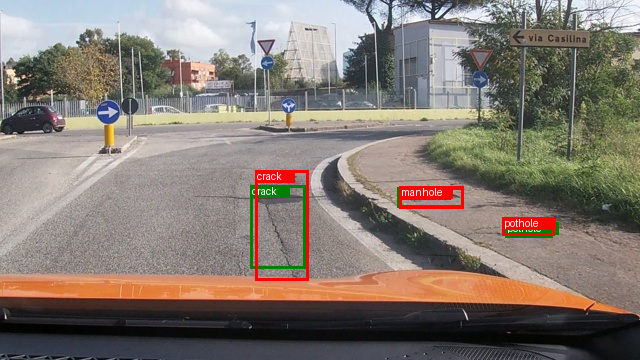
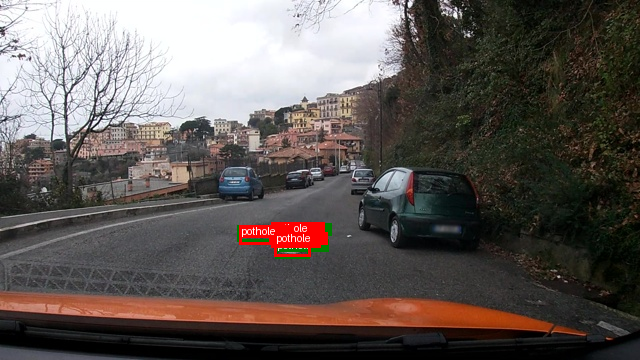
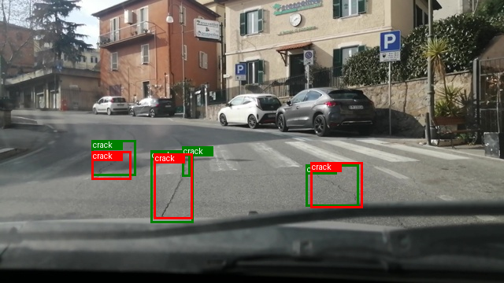
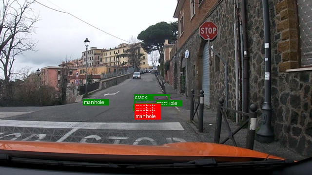
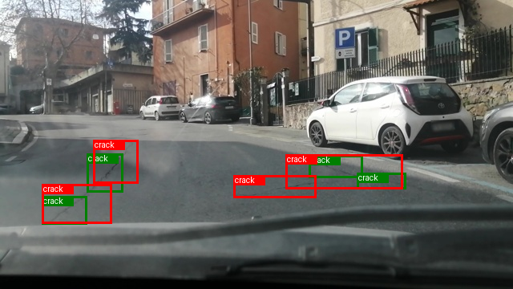
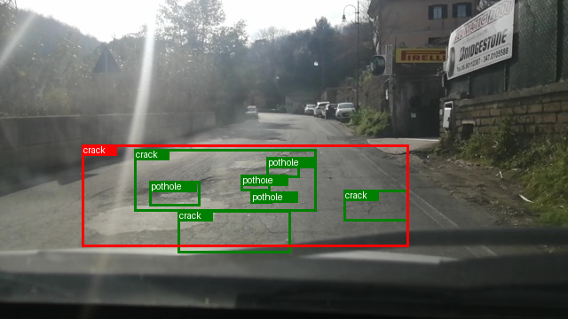

# Báo cáo Lab Day 10 — Qwen3-VL-4B định vị hư hại mặt đường

**Họ tên:** Trần Đình Duy

**Mã sinh viên:** 2A202602631

**Dataset version:** `d10-21e4070301` (output kiểm tra split đã lưu trong `lab_day10.ipynb`).

> **Trạng thái bằng chứng:** `report/evidence/e0.json`–`e3.json`, `e4_rank_4.json`, `e4_rank_64.json` và `e5.json` là kết quả chấm thật trên cùng 311 ảnh test (`dataset_version=d10-21e4070301`), đã đối chiếu với `data/splits/meta.json`. Bảng dưới đây lấy trực tiếp từ các file đó; các số thập phân được làm tròn tới 6 chữ số. Metadata E1/E2 và E5 được đối chiếu thêm với `report/training/*_run.json`; log GRPO E5 và hai file dự đoán E3/E5 cũng được lưu trong `report/`. Sáu ảnh minh họa từ dự đoán E3 được đính kèm ở Câu 9.

## Bảng tổng hợp

| Mã | Setup | Tham số huấn luyện | VRAM đỉnh (GB) | Phút | F1@IoU0.5 | CI95 | FP/ảnh | F1 pothole | F1 crack | F1 manhole |
|---|---|---:|---:|---:|---:|---|---:|---:|---:|---:|
| E0 | Zero-shot | 0 | Không áp dụng | Không áp dụng | 0,095346 | 0,066736–0,124861 | 0,823151 | 0,123457 | 0,028986 | 0,211864 |
| E1 | LoRA LLM | 33.030.144 | 10,362413 | 44,251577 | 0,262626 | 0,227066–0,302457 | 1,167203 | 0,172973 | 0,188737 | 0,526316 |
| E2 | E1 + mở projector | 142.135.296 | 8,419290 | 44,454236 | 0,324910 | 0,285470–0,365672 | 1,109325 | 0,187755 | 0,246998 | 0,607143 |
| E3 | E2 + LoRA ViT | 148.426.752 | 11,867236 | 50,290870 | 0,435411 | 0,393443–0,480148 | 0,909968 | 0,304147 | 0,373109 | 0,657627 |
| E4 r=4 | E3 + LoRA rank 4, alpha=8 | 118.935.552 | 11,429017 | 49,956769 | 0,455516 | 0,416523–0,495528 | 0,916399 | 0,302521 | 0,378378 | 0,734694 |
| E4 r=64 | E3 + LoRA rank 64, alpha=128 | 266.391.552 | 13,664224 | 52,119019 | 0,448339 | 0,408747–0,489152 | 0,829582 | 0,294931 | 0,370884 | 0,717241 |
| E5 | GRPO từ checkpoint E3 | 148.426.752 | 6,098493 | 21,595627 | 0,430988 | 0,387597–0,477585 | 0,958199 | 0,305970 | 0,365591 | 0,666667 |

E0 không có tham số được huấn luyện, nên hai cột tài nguyên huấn luyện không áp dụng. E1/E2 đều hoàn thành 300 bước; loss cuối lần lượt là 0,556115 và 0,483487 theo `run.json`. E3 có metadata huấn luyện trong evidence; chưa có `run.json` E3 ở local để bổ sung loss cuối. E5 hoàn thành 60 bước GRPO; VRAM E5 được reset bộ đếm ngay trước khi train trên model đã nạp, nên không dùng chênh lệch VRAM E5−E3 để suy ra tiết kiệm bộ nhớ giữa hai phương pháp. Các giá trị gốc đầy đủ nằm trong evidence, không lấy từ số làm tròn trong bảng để tính chênh lệch.

## 10 câu hỏi

### Câu 1 — Kiến trúc ViT, projector, LLM và khối được cập nhật

Luồng suy luận là **ảnh → ViT → merger/projector → embedding của LLM → chuỗi JSON**. ViT lấy đặc trưng ảnh, projector đưa đặc trưng đó về chiều ẩn của mô hình ngôn ngữ, rồi LLM sinh nhãn và bốn tọa độ bằng token. Ở mẫu 640×360 đã kiểm tra, `image_grid_thw=[1,22,40]`; gộp không gian 2×2 cho `22×40/4 = 220` token thị giác.

E1 chỉ cập nhật LoRA trên LLM: 252 module LoRA, 33.030.144 tham số trainable theo output chạy. E2 giữ LoRA LLM và mở `visual.merger` cùng `visual.deepstack_merger_list`: notebook đếm **109.105.152** tham số projector và **142.135.296** tham số trainable tổng. E3 thêm LoRA vào attention/MLP của ViT: output setup ghi **348** module LoRA và evidence ghi **148.426.752** tham số trainable. Số tham số **toàn bộ** ViT và **toàn bộ** LLM chưa được đo từ mô hình đang dùng, nên chưa thể báo cáo hai con số đó như kết quả của mình. Cần in tổng `numel()` theo tiền tố `model.visual` và `model.language_model` trên model gốc khi có GPU, rồi ghi vào đây.

### Câu 2 — Baseline E0

`e0.json` ghi `parse_valid_rate = 0,893891` trên **311** ảnh: khoảng 10,6% đầu ra không được parser công nhận. E0 đạt precision **0,140940**, recall **0,072041**, F1 **0,095346** và CI95 **[0,066736; 0,124861]**. Có **42 TP, 256 FP, 541 FN**; recall thấp cho thấy mô hình bỏ sót nhiều box ở ngưỡng IoU 0,5. Crack yếu nhất với recall **0,023411**. Chưa có `work/e0.jsonl` ở local để phân loại dạng lỗi JSON; ví dụ raw từng thấy trong notebook `[{"label":"manhole","bbox_2d": [770, 640, 843, 687]}]` là JSON đúng cú pháp, không phải minh chứng parse lỗi.

Sau SFT, E1 có `parse_valid_rate = 0,993569`, F1 **0,262626**, hơn E0 **0,167280** điểm F1; cả điều kiện parse ≥ 0,95 và chênh F1 ≥ 0,10 của rubric đều đạt theo hai file evidence. E2 có parse hợp lệ **1,0** và F1 **0,324910**.

### Câu 3 — Thang tọa độ 0–1000 và pixel

Nhãn YOLO `[xc,yc,w,h]` trong `[0,1]` được đổi thành `(xc±w/2, yc±h/2)×1000`, làm tròn và chặn về `[0,1000]`. Một box có x trong khoảng 320–480 pixel ở ảnh rộng 640 tương ứng x khoảng 500–750 trên thang 1000. Nếu gửi box 0–1000 cho `score.py --coord pixel`, trọng tài sẽ tiếp tục chia x cho 640 và y cho 360 rồi nhân 1000: box bị phóng/đẩy lệch, IoU và F1 thay đổi. Chiều ngược lại làm box bị co về gần góc trên trái. Kiểm tra trong mã notebook: `objects_to_answer` dùng thang 1000; E0 và các setup mặc định chấm `norm1000`, còn E4 pixel phải dùng `--coord pixel`.

Đã chấm đối chứng **cùng một file dự đoán thật `work/e3.jsonl` trên cùng 311 ảnh** bằng `score.py`: `--coord norm1000` cho **241 TP, F1 0,435411**; cố tình đổi duy nhất cờ sang `--coord pixel` cho **0 TP, F1 0,000000**, dù `parse_valid_rate` vẫn là **1,0**. Đây là kiểm tra lỗi diễn giải tọa độ, không phải một lần huấn luyện hoặc một evidence thay thế E3. Lệnh đối chứng: `python scripts/score.py --pred work/e3.jsonl --name E3_wrong_coord --split test --coord pixel --out work/e3_wrong_coord.json`.

### Câu 4 — Mask loss trên câu trả lời assistant

Mục tiêu SFT là dự đoán JSON của assistant theo điều kiện ảnh và prompt. Hàm `encode_example` tạo hai chuỗi bằng cùng chat template: chuỗi kết thúc ngay trước câu trả lời (`add_generation_prompt=True`) và chuỗi đầy đủ có câu trả lời. Notebook xác nhận chuỗi prompt là **tiền tố** của chuỗi đầy đủ, sau đó gán `labels[:n_prompt] = -100`. PyTorch bỏ qua các vị trí này khi tính cross entropy; chỉ JSON đáp án và token kết thúc assistant đóng góp vào loss. Khi padding batch, nhãn padding cũng là `-100`, còn `pixel_values` và `image_grid_thw` được nối theo chiều 0.

Kiểm tra mẫu thực tế trong notebook: `image_grid_thw=[1,22,40]`, tương ứng **220 token ảnh** sau merge; giải mã các token có nhãn khác `-100` cho JSON đáp án rồi `<|im_end|>`. Nếu tính loss cả prompt và vị trí token ảnh trong chuỗi, gradient sẽ tối ưu thêm việc dự đoán lại phần điều kiện đã cho thay vì tập trung vào chuỗi box đích. Cách nói “tái tạo ảnh” chỉ là diễn giải trực giác: loss ngôn ngữ áp lên token/placeholder, không trực tiếp hồi quy lại pixel ảnh.

### Câu 5 — Lượng tử hóa, projector và float32

Để E2 cập nhật projector đầy đủ, các lớp `visual.merger` và `visual.deepstack_merger_list` phải giữ trọng số khả vi dạng floating point. Notebook hiện dùng `llm_int8_skip_modules=["model.visual", "lm_head"]` khi nạp QLoRA NF4, nhằm giữ nhánh thị giác, bao gồm projector nằm bên trong `model.visual`, khỏi bị thay bằng lớp BitsAndBytes 4-bit. Trước đó cấu hình skip không khớp tên module đã dẫn tới trường hợp chỉ đếm được khoảng **54,58 triệu** tham số projector, trong khi bản hiện tại đếm **109.105.152**. Lượng tử hóa riêng ViT không phải định luật khiến mọi projector không thể train; vấn đề của mô hình và cấu hình này là projector **cùng nằm trong nhánh visual bị lượng tử hóa**.

Lần chạy E2 cũ lỗi `Attempting to unscale FP16 gradients`; kiểm tra optimizer khi đó thấy **8 bias** projector còn gradient FP16. Mã sửa chuyển **toàn bộ tham số trainable** sang `float32` trước khi tạo optimizer, rồi xác nhận tập dtype trainable chỉ gồm `torch.float32`. Cách này tránh lỗi `GradScaler` và giúp cập nhật projector ổn định hơn trong môi trường tính toán FP16. Metadata E2 sau sửa xác nhận train đủ 300 bước, loss cuối **0,483486570417881**, VRAM đỉnh **8,419289588928223 GB**. Trọng số projector được lưu riêng trong `projector.pt` và phải nạp lại khi suy luận E2/E3.

### Câu 6 — Chia dữ liệu theo phiên quay

Frame liên tiếp của dashcam có gần như cùng cảnh và cùng hư hại. Nếu chia ngẫu nhiên theo ảnh, frame lân cận có thể rơi vào train và test, làm F1 test đo khả năng nhận lại cảnh quen thay vì khái quát sang phiên quay mới. `prepare_data.py` gom theo tiền tố ngày/giờ của tên ảnh, rồi chia tất định theo session. Output kiểm tra trong notebook cho thấy **không có session trùng giữa các split**.

| Split | Ảnh | Session | Pothole | Crack | Manhole | Tổng box |
|---|---:|---:|---:|---:|---:|---:|
| Train | 1.422 | 13 | 1.074 | 1.750 | 691 | 3.515 |
| Val | 276 | 2 | 66 | 470 | 103 | 639 |
| Test | 311 | 3 | 121 | 299 | 163 | 583 |

Tổng là **2.009 ảnh**, **18 session**, **4.737 box**. Split theo session tạo lệch lớp thực tế; ví dụ val chỉ có 66 pothole, nên cần đọc F1 theo lớp và CI95.

### Câu 7 — E1/E2/E3: lợi ích so với tài nguyên

E1 cập nhật **33.030.144** tham số, chạy **44,251577 phút** cho 300 bước với VRAM đỉnh **10,362413 GB**. F1 test đạt **0,262626**, CI95 **[0,227066; 0,302457]**, tăng **0,167280** so với E0. E2 mở thêm projector, nâng số trainable lên **142.135.296** (thêm **109.105.152**), chạy **44,454236 phút**, VRAM đỉnh **8,419290 GB**. F1 E2 là **0,324910**, CI95 **[0,285470; 0,365672]**, tăng **0,062283** so với E1. E2 có **180 TP, 345 FP, 403 FN**, so với E1 là **143 TP, 363 FP, 440 FN**; trên test này, việc mở projector đi cùng tăng TP và giảm cả FP lẫn FN.

E3 mở thêm LoRA ViT, cập nhật **148.426.752** tham số (thêm **6.291.456** so với E2), chạy **50,290870 phút** với VRAM đỉnh **11,867236 GB**. F1 E3 đạt **0,435411**, CI95 **[0,393443; 0,480148]**, cao hơn E2 **0,110501**. E3 có **241 TP, 283 FP, 342 FN**: thêm 61 TP, giảm 62 FP và 61 FN so với E2. Trên lần chạy này, cải thiện F1 đi cùng tăng khoảng **5,837 phút** và **3,448 GB** VRAM đỉnh so với E2.

Hai CI95 của E1/E2 giao nhau tại khoảng **[0,285470; 0,302457]**; CI95 E2/E3 thì tách rời vì cận trên E2 **0,365672** thấp hơn cận dưới E3 **0,393443**. Kết quả test ủng hộ E3 trong phạm vi 311 ảnh đã chấm, nhưng cần prediction theo ảnh để bootstrap hiệu F1 ghép cặp và đánh giá session mới. VRAM E2 đo được thấp hơn E1 dù có nhiều tham số trainable hơn; đây là hai phép đo ở các lượt chạy khác nhau, không chứng minh E2 ít tốn bộ nhớ về mặt kiến trúc.

### Câu 8 — CI95 trên 311 ảnh

Trọng tài bootstrap lấy mẫu lại **311 ảnh có hoàn lại**, tính micro F1 cho mỗi mẫu, lặp **1.000** lần với seed cố định và lấy các phân vị 2,5%–97,5%. CI95 trong evidence là E0 **[0,066736; 0,124861]** (rộng **0,058124**), E1 **[0,227066; 0,302457]** (rộng **0,075391**), E2 **[0,285470; 0,365672]** (rộng **0,080202**) và E3 **[0,393443; 0,480148]** (rộng **0,086705**). F1 điểm lần lượt **0,095346**, **0,262626**, **0,324910**, **0,435411**. Độ rộng tăng dần trong các lần bootstrap này; chỉ từ JSON tổng hợp chưa thể quy nguyên nhân cụ thể cho chênh lệch độ rộng.

Tập test chỉ có **3 session**, nên bootstrap theo ảnh có thể đánh giá thấp sự bất định khi triển khai trên session hoàn toàn mới. Từ `work/e3.jsonl` và `test.jsonl`, chấm riêng ba session cho E3 được: `num-4` **15 ảnh, F1 0,541667**; `vlc-2025-02-18-23` **213 ảnh, F1 0,452414**; `vlc-2025-02-19-17` **83 ảnh, F1 0,383234**. Đây là các phép đo mô tả với cỡ session rất khác nhau, không phải CI cho quần thể phiên quay mới. E0/E1 và E2/E3 có CI tách rời, còn E1/E2 có CI giao nhau. Cùng một tập ảnh tạo phụ thuộc giữa các setup; muốn kết luận chênh lệch cần bootstrap **hiệu F1 theo cặp trên cùng ảnh**. Hiện mới có prediction JSONL E3 ở local, chưa có các file prediction của E0–E2 và hai nhánh E4 để làm phép bootstrap ghép cặp đó.

### Câu 9 — Lỗi theo lớp và ảnh minh họa

Ở E0, **crack yếu nhất**: P **0,038043**, R **0,023411**, F1 **0,028986**; pothole F1 **0,123457**, manhole F1 **0,211864**. E1 nâng F1 crack lên **0,188737**, E2 lên **0,246998**, E3 lên **0,373109**. E3 đạt F1 pothole **0,304147** và manhole **0,657627**. Tuy vậy, crack vẫn có **185 FP, 188 FN** ở E3, nên là lớp cần ưu tiên xem ảnh sai. Test có **299** box crack, nhiều hơn pothole (**121**), vì vậy không thể quy kết kết quả thấp đơn thuần do thiếu mẫu test.

Sáu ảnh test dưới đây được tạo từ **ảnh thật, GT trong `test.jsonl` và đầu ra E3 trong `work/e3.jsonl`**. **Xanh lá** là box GT, **đỏ** là box dự đoán; TP/FP/FN dùng cùng lớp và IoU ≥ 0,5 như trọng tài. Nhóm “có TP” gồm cả một ảnh còn FN, để không che giấu lỗi.

1. **Đúng cả ba lớp**, TP=3, FP=0, FN=0: crack, manhole và pothole đều được ghép đúng.

   

2. **Ba pothole được phát hiện**, TP=3, FP=0, FN=0, trong ảnh cùng một phiên test khác.

   

3. **Ba crack đúng, một crack bị bỏ sót**, TP=3, FP=0, FN=1. Đây là trường hợp đúng một phần, không phải ảnh hoàn hảo.

   

4. **Nhầm lớp và lặp box**, TP=0, FP=5, FN=4: mô hình sinh năm box `manhole` chồng nhau tại khu vực có pothole; hai manhole GT, một crack và pothole đều không được ghép đúng.

   

5. **Crack có box nhưng lệch hình học**, TP=0, FP=4, FN=4: bốn box dự đoán đều mang đúng nhãn crack nhưng không đạt IoU 0,5 với box GT; đây là lỗi định vị, không phải JSON hỏng.

   

6. **Một box crack quá rộng**, TP=0, FP=1, FN=7: box đỏ bao gần hết vùng hư hại phía trước nhưng không khớp đủ IoU với ba crack GT, đồng thời bỏ sót bốn pothole.

   

Hai ảnh crack ở mốc `23h29m04s` và `23h29m07s` chỉ cách nhau khoảng **3 giây** và cùng thuộc session test `vlc-2025-02-18-23`. Chúng minh họa trực quan lý do phải giữ nguyên session trong một split. Sáu ảnh cùng thống kê từng ảnh cũng được liệt kê tại [`report/examples/README.md`](report/examples/README.md).

### Câu 10 — E4 ablation đơn biến

E4 thay đổi **biến rank LoRA** trên cùng setup nền **E3**, được chọn vì F1 E3 **0,435411** cao nhất trong E1–E3. Hai mức là `r=4, alpha=8` và `r=64, alpha=128`; `alpha=2r` giữ tỉ số alpha/r bằng 2 theo cấu hình của đề. Evidence hai nhánh cùng `base_setup=E3`, `train_fraction=1`, learning rate **0,0002**, batch size **2**, grad accumulation **4**, effective batch **8**, split **test** và thang `norm1000`. Notebook dùng cùng prompt, dữ liệu và số bước **300**; khác biệt có chủ đích là độ rộng LoRA cùng alpha đi theo quy tắc trên.

Rank **4** đạt F1 **0,455516**, CI95 **[0,416523; 0,495528]**; rank **64** đạt F1 **0,448339**, CI95 **[0,408747; 0,489152]**. Chênh lệch F1 r4−r64 là **0,007177** trên 311 ảnh. Hai CI giao nhau trong khoảng **[0,416523; 0,489152]**, nên chưa có cơ sở từ các CI riêng để khẳng định rank 4 tốt hơn rank 64. Rank 64 dùng **266.391.552** tham số trainable, hơn rank 4 **147.456.000**; VRAM đỉnh **13,664224 GB** so với **11,429017 GB**, thời gian **52,119019** so với **49,956769 phút**. Với kết quả quan sát được, rank 4 đạt F1 nhỉnh hơn và dùng ít tài nguyên hơn; cần prediction theo ảnh để bootstrap hiệu F1 ghép cặp trước khi đưa ra kết luận chắc chắn. Cả hai CI cũng giao với CI E3 rank 16, nên chưa thể kết luận hai cực rank cải thiện so với E3 chuẩn.

## Bonus E5 — GRPO với reward IoU

Hàm `compute_reward` trong [`e5_reward.py`](e5_reward.py) trả **0** nếu JSON không parse được, **1** nếu cả GT và dự đoán đều rỗng. Với JSON hợp lệ khác, reward bằng `0,2 + 0,8 × tổng IoU của các cặp cùng lớp, IoU ≥ 0,5 / max(N_GT, N_pred, 1)`. Ghép cặp greedy dùng mỗi box tối đa một lần. Năm ca kiểm tra độc lập cho kết quả: box hoàn hảo **1,0**, JSON hỏng **0,0**, sai lớp **0,2**, thừa một box **0,6**, cùng rỗng **1,0**. Mã nguồn và dữ liệu đầu vào của các ca nằm ngay trong `run_reward_unit_checks()`.

GRPO khởi tạo từ checkpoint **E3**, lấy **4** phương án cho mỗi prompt, learning rate **5×10⁻⁶**, `beta=0`, seed **42**, hoàn thành **60/60 bước**. [`report/training/e5_trainer_log.json`](report/training/e5_trainer_log.json) có 60 dòng reward/loss theo bước và một dòng tổng kết; [`report/training/e5_run.json`](report/training/e5_run.json) xác nhận **148.426.752** tham số trainable, **21,595627 phút** và VRAM đỉnh đo được **6,098493 GB**. Reward trung bình của 10 bước đầu **0,309005**, 10 bước cuối **0,349989**; các bước lấy prompt khác nhau nên hai trung bình này không chứng minh chất lượng tăng theo thời gian. Có **5/60** bước có độ lệch chuẩn reward trong nhóm bằng 0 và `grad_norm=0`; bước 60 nhận reward **0,2** với độ lệch chuẩn **0**. Đây là dấu hiệu một số nhóm không tạo được tín hiệu so sánh để cập nhật, không đủ để kết luận toàn bộ training sụp đổ. Loss GRPO có thể âm và không diễn giải như cross-entropy SFT.

Trọng tài chấm lại [`report/predictions/e5.jsonl`](report/predictions/e5.jsonl) khớp **mọi trường điểm** trong [`e5.json`](report/evidence/e5.json): **311/311** ảnh, parse hợp lệ **1,0**, **242 TP, 298 FP, 341 FN**, precision **0,448148**, recall **0,415094**, F1 **0,430988**, CI95 **[0,387597; 0,477585]**. E3 có F1 **0,435411**, CI95 **[0,393443; 0,480148]**; chênh E5−E3 là **−0,004423**. E5 hơn E3 một TP nhưng thêm 15 FP, nên F1 giảm nhẹ. Theo lớp, F1 pothole **0,305970** so với E3 **0,304147**; crack **0,365591** so với **0,373109**; manhole **0,666667** so với **0,657627**.

Hai CI riêng giao nhau. Dùng cùng 311 ảnh để bootstrap **hiệu F1 ghép cặp** 5.000 lần (seed 42) cho CI95 E5−E3 **[−0,025298; 0,015960]**; khoảng này chứa 0, nên chưa thấy cải thiện rõ của E5 so với SFT E3. Đây vẫn là bootstrap theo ảnh trên chỉ **3 session test**, chưa đo được bất định khi chuyển sang một phiên quay mới. Phép tính có thể tái tạo bằng [`report/e5_audit.py`](report/e5_audit.py) với hai file dự đoán trong `report/predictions/` và `data/splits/test.jsonl`; kết quả máy đọc được nằm tại [`report/training/e5_audit.json`](report/training/e5_audit.json).

Về reward hacking, trả `[]` cho ảnh có GT chỉ nhận **0,2**, còn một box quá lớn thường không đạt ngưỡng IoU **0,5**; mẫu số `max(N_GT,N_pred,1)` phạt box thừa. Kiểm tra **đầu ra suy luận xác định** của E5 trên 311 ảnh test, tất cả đều có GT, thấy **0** dự đoán rỗng, **0** box chiếm ≥50% diện tích ảnh, **0** box ngoài thang 0–1000 và **0** cặp box cùng lớp gần trùng nhau ở IoU ≥0,9. Điều này chỉ kiểm tra đầu ra test đã lưu, không bao phủ toàn bộ 4 phương án ngẫu nhiên trong mỗi nhóm GRPO. Mức thưởng nền **0,2** cho JSON hợp lệ nhưng không ghép trúng vẫn có thể tạo nhóm cùng reward, phù hợp với 5 bước có reward variance bằng 0 trong log.

## Nhìn lại và việc còn thiếu trước khi nộp

Các lỗi thực tế đã gặp: gradient FP16 của 8 bias projector làm `GradScaler` dừng E2; sai cấu hình skip visual khiến projector không được mở đầy đủ; `CheckpointError` khi kết hợp gradient checkpointing với nhánh thị giác; `torchao 0.10.0` không tương thích PEFT ở lần thử E3 đầu; phiên Colab cũ hết GPU, sau đó chuyển sang tài khoản khác và dùng lối tắt Drive để đọc checkpoint; E5 cần khôi phục tham số trainable FP32 và autocast FP16 ở rollout. E0–E3, cả hai nhánh E4 và E5 đều đã có evidence chính thức; sáu ảnh đối chiếu E3 thật đã được đính kèm. `data/splits/meta.json` trong zip Colab khớp dataset version của tất cả evidence. Phần thưởng E5 đã có log và dự đoán để đối chiếu; F1 không tăng so với E3 trong lần chạy này.
